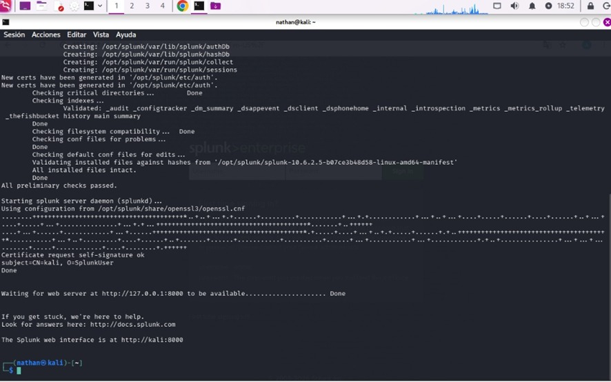
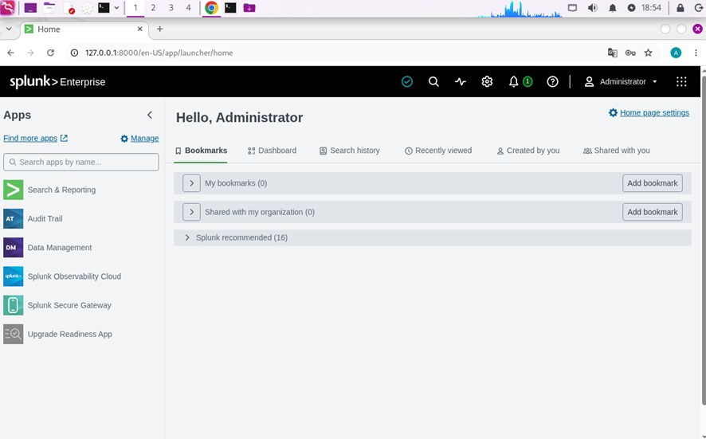
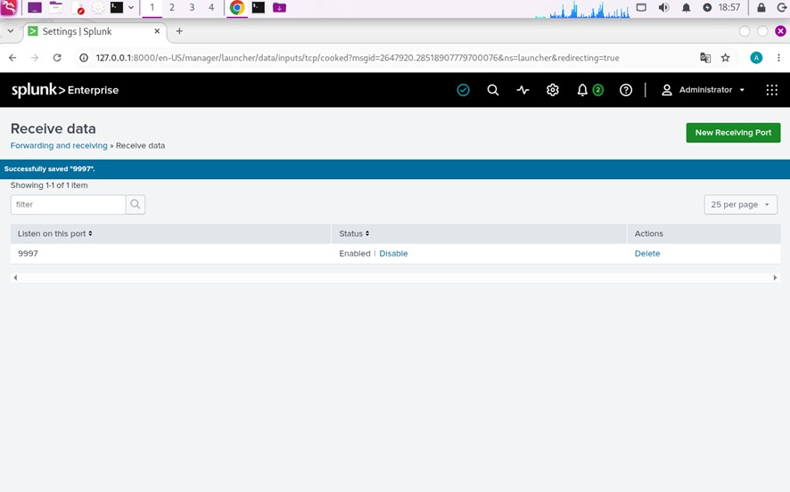
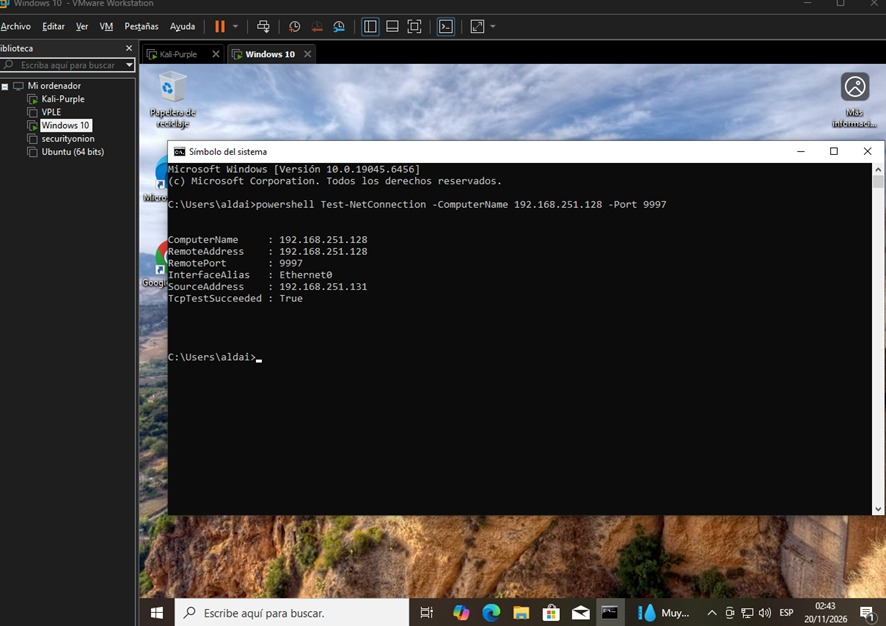
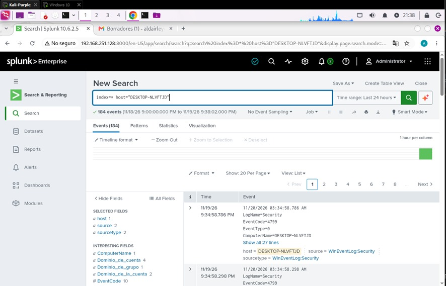
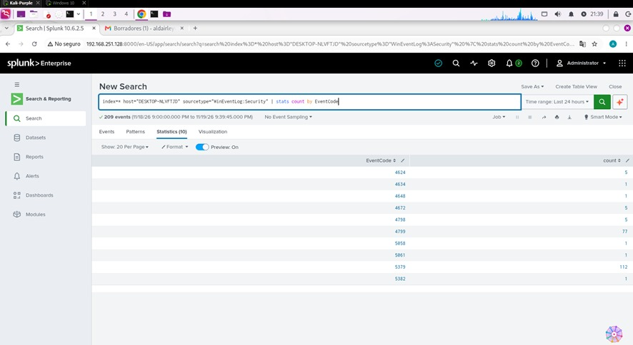

# 🛡️ SOC Lab: Windows Endpoint Telemetry & SIEM Ingestion with Splunk

## 📋 Project Overview

This lab documents the deployment, configuration, and validation of a centralized Security Information and Event Management (SIEM) monitoring architecture. The objective is to ingest critical event logs (*Application*, *Security*, and *System*) from a **Windows 10** endpoint into a **Splunk Enterprise** server hosted on **Kali Purple**, simulating the log visibility, threat detection, and triage workflow of a **Tier 1 SOC Analyst**.

### 🏗️ Lab Architecture
* **SIEM Server (Receiver):** Kali Purple (`192.168.251.128`) running Splunk Enterprise listening on TCP port `9997`.
* **Monitored Endpoint (Agent):** Windows 10 (`DESKTOP-NLVFTJD`) running **Splunk Universal Forwarder**.
* **Ingested Log Sources:** `WinEventLog:Application`, `WinEventLog:Security`, `WinEventLog:System`.

---

## ⚙️ Implementation Phases & Evidence

### 1. Agent Configuration (Splunk Universal Forwarder)
Local configuration files were deployed under `C:\Archivos de programa\SplunkUniversalForwarder\etc\system\local\` using an elevated PowerShell session to enable Windows Event Log collection and define the receiving indexer.

* **`inputs.conf`**: Enables monitoring for Application, Security, and System channels (`disabled = 0`).
* **`outputs.conf`**: Routes endpoint telemetry to the SIEM indexer (`server = 192.168.251.128:9997`).



### 2. Endpoint Service Validation
After applying the configuration files, the `SplunkForwarder` service was restarted on Windows 10 to establish a persistent forwarding connection with the receiving server.



### 3. Splunk SIEM Listening Port Configuration
Within the Splunk Enterprise web interface (*Settings > Forwarding and receiving > Configure receiving*), TCP port **9997** was enabled to ingest incoming telemetry from network forwarders.



### 4. Connectivity & Initial Ingestion Check
An open query (`index=*`) was executed in the *Search & Reporting* app to verify the arrival of initial telemetry packets at the SIEM server.



### 5. Host-Specific Telemetry Isolation
Events were isolated using the monitored endpoint's hostname (`index=* host="DESKTOP-NLVFTJD"`), confirming the successful ingestion of **184+ events** with parsed fields including `LogName`, `EventCode`, and `ComputerName`.



### 6. Security Event Analysis with SPL
To demonstrate SOC detection and triage capabilities, an analytical query was executed using **SPL (Splunk Processing Language)** to aggregate and count active security event codes:

```splunk
index=* host="DESKTOP-NLVFTJD" sourcetype="WinEventLog:Security" | stats count by EventCode
```

**Key Telemetry Findings (209 events analyzed):**
* **EventCode 4624 (5 events):** Successful account logons on the endpoint.
* **EventCode 4672 (5 events):** Special privileges assigned to a new logon (critical indicator for privilege escalation monitoring).
* **EventCode 4648 (1 event):** Logon attempted using explicit credentials.
* **EventCode 4799 / 5379 (77 / 112 events):** Security-enabled local group membership enumeration and Windows Credential Manager read operations.



---

## 💡 Lessons Learned & Troubleshooting
* **File Extensions & Encoding on Windows:** Creating `.conf` files via GUI text editors can append hidden `.txt` extensions. Using `Set-Content -Encoding Ascii` in PowerShell ensures clean, properly formatted configuration files readable by Splunk.
* **Time Synchronization (NTP):** Clock skew between the endpoint and the SIEM server causes logs to arrive with future or past timestamps, requiring time-range adjustments (*All time*) during lab validation or strict NTP synchronization in production environments.